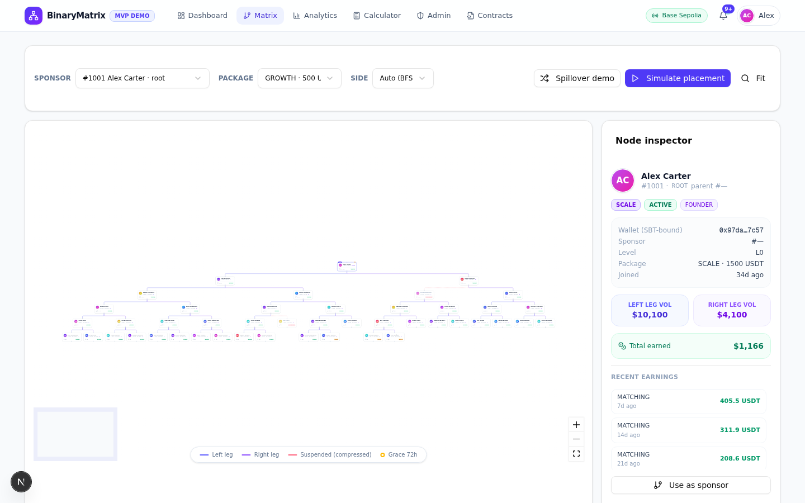
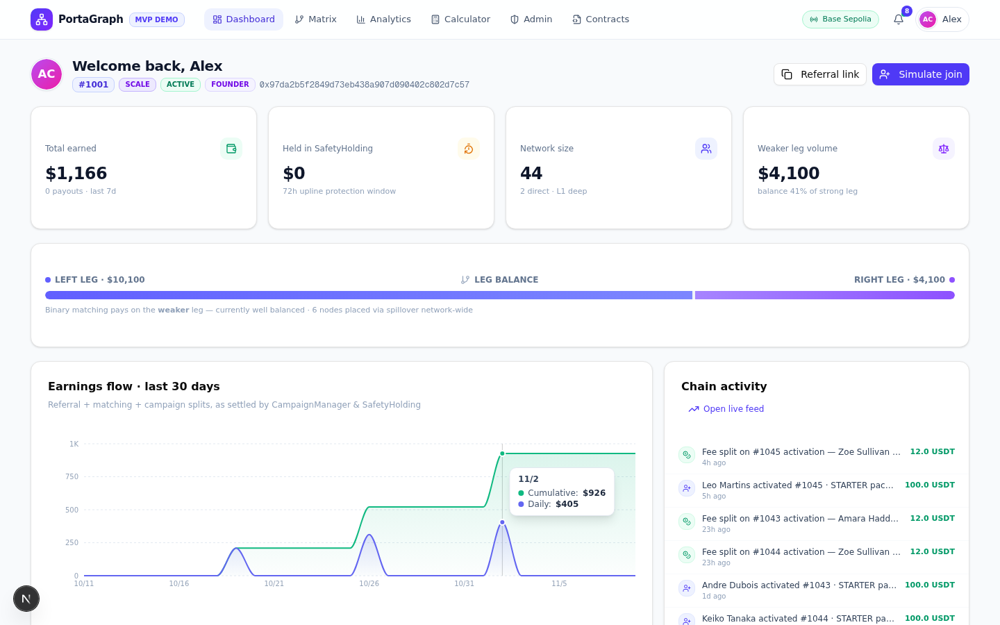
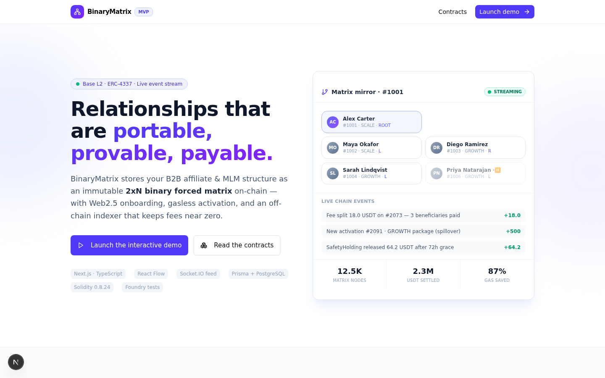
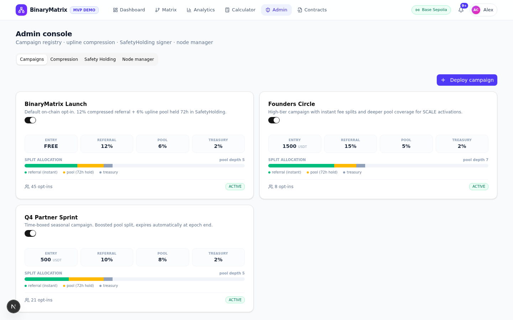

<div align="center">

# PortaGraph

**The Portable Relationship Protocol — MVP Demo**

An immutable 2×N binary forced matrix with soulbound identity, instant compressed fee splits, and a 72-hour safety holding window. Built to demonstrate what B2B referral networks look like when the relationship graph lives on-chain and the heavy math runs off-chain.

Live demo: **https://portagraph-demo.vercel.app/** · Contracts: **Base L2 (Solidity)** · Indexer: **off-chain BFS**

    

</div>

---

## Screenshots

| Matrix (45 nodes, live BFS) | Founder dashboard |
| --- | --- |
|  |  |
| **Landing** | **Admin console** |
|  |  |

## What this demo proves

PortaGraph is a protocol pitch: *your network position should be a soulbound asset you own — not a database row a company can edit.* This MVP demonstrates the full stack end-to-end:

1. **Immutable 2×N binary forced matrix** — every member is an SBT (soulbound NFT, ERC-721 with transfers disabled) bound to a permanent parent/side slot. Transfers are rejected at the contract level.
2. **Off-chain BFS indexer** — the on-chain `findPlacement` BFS costs gas that grows with the tree. The indexer runs the identical BFS off-chain and submits only the final slot via `placeAt` — **~87% gas savings** on a 45-node tree (see `src/lib/indexer.ts` for the cost model).
3. **Upline compression** — suspended/inactive uplines are skipped in fee routing. Suspend a node in the Admin console and watch splits re-route live, with the skipped path struck through.
4. **Instant splits + 72h SafetyHolding** — activation fees split immediately to the compressed referral upline and the upline pool; the pool share is held 72 hours (reversible by a safety signer) before release.
5. **Web2.5 onboarding** — email/Google/X sign-in provisions an embedded wallet, mints the SBT, and shows the exact BFS path and fee splits — no seed phrase, no MetaMask required (MetaMask is also supported).

All of this runs against a **real Solidity contract suite** (`contracts/`), viewable in the app's Contracts tab, with a Foundry test suite.

## Demo data

The app ships with a deterministic **45-node seed network** (5 levels, 3 campaigns, ~180 ledger entries):

- **#1006 and #1021 are SUSPENDED** → used to demonstrate upline compression
- **#1043 / #1044 / #1045 are in GRACE** → live entries in the 72h SafetyHolding window
- **6 nodes have sponsor ≠ placement parent** → real spillover evidence

On Vercel (ephemeral filesystem) the database **re-creates and re-seeds itself automatically** on every cold start, so the demo always opens in the same pristine state. Locally you can reset anytime with `npm run db:seed`.

## Architecture

```
┌──────────────────────────────────────────────────────────────────┐
│                        Browser (React 19)                        │
│  Landing · Auth (Web2.5) · Matrix (React Flow) · Analytics ·     │
│  Calculator · Admin console · Contracts viewer                   │
└───────────────┬──────────────────────────────────┬───────────────┘
                │ REST (fetch, 9s polling fallback)│ socket.io (optional)
┌───────────────▼──────────────────────────────────▼───────────────┐
│                   Next.js 16 API routes (Node)                   │
│  /api/join      BFS placement → SBT mint → split → hold          │
│  /api/network   full mirror snapshot (users/events/earnings)     │
│  /api/holding   SafetyHolding signer ops (release/reverse/crank) │
│  /api/nodes     registry-signer status changes (compression)     │
│  /api/campaigns deploy/toggle campaign fee splits                │
│  /api/contracts serve Solidity sources to the viewer             │
└───────┬─────────────────────────────────┬────────────────────────┘
        │ Prisma                          │ relay (best-effort)
┌───────▼────────┐              ┌─────────▼───────────┐
│ SQLite mirror  │              │ event-stream service│  (optional,
│ (off-chain     │              │ socket.io :3003     │   local dev only:
│  indexer DB)   │              │ simulated chain mem-│   `bun run dev`
└────────────────┘              │ pool + API relays)  │
                                └─────────────────────┘
        mirrors ──────────────── PortaGraph Registry.sol ── Base L2
                                 CampaignManager.sol
                                 SafetyHolding.sol
```

The demo runs against a **simulated chain** (deterministic wallet/tx generation + block numbers) so it needs no RPC, no testnet ETH, and no keys. The Solidity contracts and their Foundry tests are the real reference implementation the indexer mirrors.

## Tech stack

| Layer | Tech |
| --- | --- |
| Framework | Next.js 16 (App Router) + TypeScript 5 |
| UI | Tailwind CSS 4, shadcn/ui, lucide-react, framer-motion |
| Matrix visualization | @xyflow/react (React Flow) |
| Charts | recharts |
| State | zustand |
| Database | Prisma 6 + SQLite (zero-config, auto-seeded) |
| Realtime | socket.io (optional mini-service, 9s polling fallback built in) |
| Contracts | Solidity (ERC-721 SBT, forced matrix, fee splitter, escrow) + Foundry tests |

## Getting started (local)

**Prerequisites:** Node.js 20+ (or Bun). No database setup, no env vars, no keys.

```bash
git clone https://github.com/rajkdas/portagraph
cd portagraph
npm install        # runs prisma generate automatically
npm run dev        # http://localhost:3000 — database auto-creates & seeds
```

Open http://localhost:3000 → **Launch demo** → *“Just exploring? Enter as the demo founder”* for the richest view.

### Optional: live event stream

The activity feed works everywhere via 9-second API polling. For true real-time push locally, run the socket service in a second terminal:

```bash
cd mini-services/event-stream && bun install && bun run dev   # port 3003
```

The header chip switches from *polling* to *socket.io streaming* automatically.

### Scripts

| Command | What it does |
| --- | --- |
| `npm run dev` | Dev server on :3000 |
| `npm run build` / `npm start` | Production build / standalone server |
| `npm run db:seed` | Reset the database to the 45-node demo network |
| `npm run db:push` | Push `prisma/schema.prisma` to the database |
| `npm run lint` | ESLint |

## Deploying your own instance

One-click: fork/clone this repo, then import it on [Vercel](https://vercel.com/new) — no environment variables needed (SQLite boots into `/tmp` and seeds itself). Full step-by-step with screenshots-level detail: **[DEPLOY.md](DEPLOY.md)**.

[](https://vercel.com/new/clone?repository-url=https%3A%2F%2Fgithub.com%2Frajkdas%2Fportagraph&project-name=portagraph&repository-name=portagraph)

> Note: on Vercel each serverless instance gets a fresh seeded database on cold start. Signup actions during a demo persist until that instance recycles — perfect for demos, not for production data.

## API endpoints

| Method | Route | Purpose |
| --- | --- | --- |
| POST | `/api/join` | Web2.5 activation: BFS placement → SBT mint → fee split → 72h hold |
| GET | `/api/network` | Full mirror snapshot (matrix, events, earnings, campaigns) |
| GET | `/api/events` | Recent chain events (feed hydration / polling fallback) |
| GET/PATCH | `/api/holding` | SafetyHolding ledger · release / reverse / `releaseAllDue` crank |
| PATCH | `/api/nodes` | Registry-signer node status changes (triggers compression) |
| GET/POST/PATCH | `/api/campaigns` | Campaign registry: list · deploy · toggle |
| GET | `/api/contracts` | Solidity sources for the in-app contract viewer |

## Smart contracts (`contracts/`)

| File | Role |
| --- | --- |
| `PortaGraphRegistry.sol` | SBT matrix: ERC-721 with `_update` locked (non-transferable), on-chain BFS `findPlacement` + `placeAt` fast path for the indexer |
| `CampaignManager.sol` | Campaign config, compressed referral routing, pool splits into SafetyHolding |
| `SafetyHolding.sol` | 72h escrow: `release` / `reverse` / `releaseAll` signer crank |
| `test/Registry.t.sol`, `test/CampaignManager.t.sol` | Foundry test suite |

## FAQ

**Is this on a real chain?**
The contracts are real Solidity with tests, but this MVP demo runs against a simulated chain (deterministic fake wallets/txs) so it works with zero keys. Wiring the indexer to Base Sepolia is the next milestone.

**Why does the feed say "polling"?**
The demo polls `/api/events` every 9s unless the optional socket service is running — on Vercel, polling is the expected channel.

**How do I reset the demo data?**
Locally: `npm run db:seed`. On Vercel: redeploy (or wait for an instance recycle) — the database re-seeds itself.

**Does it work on Windows?**
Yes — `npm run dev` runs fine; hosting happens on Vercel (Linux), so local OS differences don't matter.

## License

MIT © 2026 Raj Kumar Das
